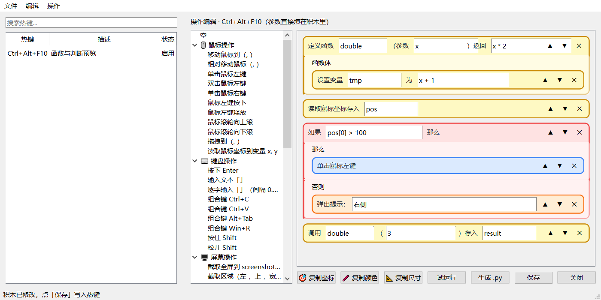

# HotKey — 热键自动化工具

拖拽式零代码自动化工具：把左侧的中文积木拖到右侧单栏里拼成脚本，既可以绑定全局热键，也可以导出成可独立运行的 Python 文件。基于 **PySide6**，界面用 **Qt Designer** 的 `.ui` 文件维护。

> 旧版 Tkinter 实现保留在 `legacy/`，可执行 `python main_tk.py` 对比；迁移计划见 [docs/PLAN-qt-migration.md](docs/PLAN-qt-migration.md)。



## 功能

- **单栏积木编辑**：竖向积木列表，`▲`/`▼` 调整顺序，`✕` 删除
- **参数常驻**：数字/文本参数就是积木里的输入框，一直显示，直接填
- **判断块**：「如果…那么…否则…」一个积木带两个槽位，子积木拖进对应分支
- **循环块**：「重复执行 3 次」带一个槽位，子积木自动缩进
- **函数**：定义函数（参数、返回值、函数体）、调用函数并接收返回值、`return` 积木
- **带返回值的内置积木**：比较、数学计算、随机数、找图、像素颜色、鼠标坐标、屏幕尺寸等
- **导出 Python**：一键生成可直接 `python 文件.py` 运行的脚本，不依赖 HotKey 热键
- **JSON 驱动**：积木目录、中文模板、参数、槽位、Python 转换与转义都在 `hotkey/core/catalog.json`
- **空积木**：左侧最顶上的「空」拖进来，可以自己写一行代码
- **热键管理**：新建 / 修改 / 删除 / 启用停用，重复组合键自动拦截
- **全局监听**：`keyboard` 注册热键，脚本在独立 worker 线程串行执行，不阻塞界面
- **系统托盘**：关闭窗口最小化到托盘，托盘菜单可启停监听或退出
- **配置持久化**：启动自动加载，改动 800ms 防抖自动保存
- **单实例**：重复启动会激活已有窗口，避免重复注册热键

## 环境要求

- Windows 10 / 11
- Python 3.10+
- 运行时依赖见 `requirements.txt`（`PySide6-Essentials`、`keyboard`、`pyautogui`）
- 导出的 `.py` 只需要 Python + `pyautogui`，不需要 PySide6

## 安装与运行

```powershell
# 开发环境（含 pytest / pyinstaller）
pip install -r requirements-dev.txt

# 运行
python main.py

# 冒烟测试：启动后自动退出
python main.py --self-test
```

打包：

```powershell
pyinstaller --noconfirm HotKey.spec
# 产物：dist\HotKey\HotKey.exe（onedir）
```

## 使用流程

1. `Ctrl+N` 打开对话框，在热键框里按下组合键（如 `Ctrl+Shift+A`），填写描述
2. 双击列表条目打开右侧积木栏
3. 从左侧「操作面板」把中文积木拖进右侧单栏；用每块右侧的 `▲`/`▼` 调整顺序
4. 直接在积木里的输入框填参数（例如把 `移动鼠标到（, ）` 的 x、y 填成 `800`、`600`）
5. 需要循环/判断/函数时，把其他积木拖进「重复内容」「那么」「否则」「函数体」槽位
6. 点「保存」，积木会先被翻译成脚本并做安全校验
7. 两种运行方式：
   - `F5` 启动监听，按热键触发
   - 点「生成 .py」或 `Ctrl+Shift+E`，导出后用 `python 文件.py` 直接运行
8. 关闭窗口会最小化到托盘；托盘右键「退出」才是真正退出

左侧最顶上的「空」是一块空白积木：拖进来后直接在它的输入框里写一行 Python 代码。

列表**从上到下**就是执行顺序；容器里的积木按放入顺序执行。

## 函数与返回值（自动化脚本重点）

自动化脚本里最常见的需求是"先取一个值，再根据这个值判断"。积木里对应三类东西：

### 1. 定义函数

积木：`定义函数 {name}（参数 {params}）返回 {result}`，带一个「函数体」槽位。

- `name`：函数名，例如 `find_and_click`
- `params`：参数列表，例如 `image, timeout`；没有参数就留空
- `result`：返回表达式，例如 `found`；留空表示不返回值
- 函数体：把其他积木拖进槽位

生成的代码：

```python
def find_and_click(image, timeout):
    found = pyautogui.locateCenterOnScreen(image)
    if found:
        pyautogui.click(found)
    return found
```

返回值统一放在函数体最后，因此在函数体里也可以先用 `返回 {value}` 做提前返回。

### 2. 调用函数

- `调用 {name}（{args}）存入 {variable}`：把返回值存进变量，例如 `pos = find_and_click('a.png')`
- `调用 {name}（{args}）`：只调用、不接收返回值

变量名不用声明，第一次赋值时就创建；后续在条件、比较、数学表达式里直接写变量名即可。

### 3. 带返回值的内置积木（函数与数据分类）

| 积木 | 写入变量 | 说明 |
|---|---|---|
| 读取鼠标坐标存入 `pos` | `pos` | `pyautogui.position()`，`pos[0]`/`pos[1]` 是 x/y |
| 读取屏幕尺寸存入 `size` | `size` | `pyautogui.size()` |
| 坐标（x, y）颜色存入 `c` | `c` | `pyautogui.pixel(x, y)`，`c[0..2]` 是 RGB |
| 图片 `a.png` 是否存在存入 `ok` | `ok` | 返回 `True/False`，可直接用于判断 |
| 查找图片 `a.png` 位置存入 `where` | `where` | 找不到时为 `None` |
| 比较 `a` `>` `b` 存入 `ok` | `ok` | 返回布尔值 |
| 计算 `x + 1` 存入 `n` | `n` | 任意数学表达式 |
| 随机整数 `1` 到 `10` 存入 `n` | `n` | `random.randint` |
| 设置变量 `name` 为 `value` | `name` | 直接赋值，也支持 `a, b = ...` 解包 |

### 4. 在判断里使用返回值

把"带返回值的积木"放在判断前面，然后在「如果」的条件里写变量或表达式：

```
读取鼠标坐标存入 pos
比较 pos[0] > 100 存入 is_right
如果 is_right 那么
    单击鼠标左键
否则
    弹出提示：鼠标在左侧
```

也可以直接写表达式，例如条件填 `pos[0] > 100 and ok`、`pyautogui.pixelMatchesColor(1, 2, (255, 255, 255))`。

### 5. 导出成独立脚本

「生成 .py」会把当前热键的积木转成一个完整文件：

```python
"""由 HotKey 生成的自动化脚本。..."""

import json
import math
import random
import re
import time

import pyautogui


def double(x):
    return x * 2


def main():
    result = double(3)
    print('result =', result)


if __name__ == "__main__":
    main()
```

函数定义会自动排在文件前部，其余积木放进 `main()`，所以文件可以直接运行：

```powershell
python ctrl_alt_f10.py
```

这种情况下完全不需要 HotKey，也不需要热键；HotKey 只是积木编辑器和代码生成器。

## 配置文件

默认位置：`%APPDATA%\HotKey\hotkeys.json`

如果该目录不可写（受限环境、受控文件夹访问等），会依次回退到 `~/.hotkey/hotkeys.json`、`.hotkey/hotkeys.json`，日志在配置目录下的 `logs/hotkey.log`。

v5 格式（同时保留 `script` 方便执行与旧版读取）：

```json
{
  "version": 5,
  "hotkeys": [
    {
      "id": "3f2c9a...",
      "key": "ctrl+shift+a",
      "description": "弹出提示",
      "enabled": true,
      "script": "if x > 0:\n    pyautogui.click()\nelse:\n    pyautogui.alert('no')",
      "blocks": [
        {
          "kind": "flow_if_else",
          "text": "如果 x > 0 那么",
          "params": { "condition": "x > 0" },
          "x": 120, "y": 200,
          "children": [
            { "kind": "mouse_click", "text": "单击鼠标左键", "params": {}, "children": [], "else_children": [], "x": 0, "y": 0 }
          ],
          "else_children": [
            { "kind": "dialog_alert", "text": "弹出提示：no", "params": { "text": "no" }, "children": [], "else_children": [], "x": 0, "y": 0 }
          ]
        }
      ]
    }
  ]
}
```

旧版（v1~v4）的积木会自动补参数和位置，纯脚本会迁移成一个「空」积木。

## 快捷键

| 位置 | 快捷键 | 功能 |
|------|--------|------|
| 主窗口 | `Ctrl+N` | 新建热键 |
| 主窗口 | `Ctrl+O` | 导入配置 |
| 主窗口 | `Ctrl+Shift+S` | 导出配置 |
| 主窗口 | `Ctrl+Q` | 退出程序 |
| 主窗口 | `Ctrl+F` | 搜索 |
| 主窗口 | `Ctrl+E` | 显示/隐藏操作编辑 |
| 主窗口 | `F5` / `Shift+F5` | 启动 / 停止监听 |
| 主窗口 | `Ctrl+Del` | 删除选中热键 |
| 积木栏 | `Delete` | 删除选中的积木 |

## 脚本安全

积木会被翻译成整段 Python，在保存前和执行前各做一次 AST 校验：

- 允许：`pyautogui`、`time`、`datetime`、`math`、`random`、`json`、`re` 以及常用内置函数
- 禁止：`os` / `subprocess` 等模块，`eval` / `exec` / `open` / `__import__` 等调用，`__class__` 等 dunder 属性
- `import` 语句受白名单限制，执行命名空间只注入白名单模块

这是一道防误用的护栏，不是对抗恶意代码的安全边界——「空」积木本来就能写代码。

## 项目结构

```
HotKey/
├── main.py                  # 入口（--self-test）
├── main_tk.py               # 旧版 Tk 入口
├── HotKey.spec              # PyInstaller onedir 配置
├── hotkey/
│   ├── app.py               # 启动、日志、单实例
│   ├── core/                # 不依赖 Qt，可独立测试
│   │   ├── models.py        # HotKey / Block（含参数、位置、if/else 分支）
│   │   ├── blocks.py        # 积木树 -> Python 代码
│   │   ├── catalog.json     # 积木表：中文模板、参数、槽位、Python 模板
│   │   ├── catalog.py       # 加载 catalog.json 并提供渲染/转换 API
│   │   ├── storage.py       # v1~v5 迁移、原子写、目录回退
│   │   ├── validator.py     # 整段 AST 校验 + 执行命名空间
│   │   ├── keymap.py        # Qt 键名 <-> keyboard 键名
│   │   ├── hotkey_service.py# 热键注册
│   │   └── runner.py        # 单 worker 执行队列
│   └── ui/
│       ├── forms/           # Designer 源文件（main_window / hotkey_dialog）
│       ├── generated/       # pyside6-uic 生成物（提交入库）
│       ├── widgets/         # BlockListEditor（单栏）、BlockWidget（积木）、StatementTree
│       ├── main_window.py
│       ├── hotkey_model.py
│       ├── recorder.py
│       └── theme.qss
├── tests/                   # pytest + pytest-qt（147 项）
├── tools/build_ui.ps1       # .ui -> generated/ui_*.py
└── legacy/                  # 旧 Tk 实现（仅参考）
```

## 开发

修改界面：用 Qt Designer 打开 `hotkey/ui/forms/*.ui`，保存后重新生成：

```powershell
.\.venv\Scripts\pyside6-designer.exe hotkey\ui\forms\main_window.ui
powershell -ExecutionPolicy Bypass -File tools\build_ui.ps1
```

生成物需要提交；`pytest` 里有一项会用 `build_ui.ps1 -Check` 检查 `.ui` 与生成物是否同步。

新增/修改积木：编辑 `hotkey/core/catalog.json`，每条包含中文 `label`、Python `code`、参数表，容器积木再加 `slots`：

```json
{
  "id": "flow_if_else",
  "category": "flow",
  "label": "如果 {condition} 那么",
  "code": "if {condition}:",
  "block": true,
  "params": [
    { "name": "condition", "placeholder": "条件，例如 x > 0", "kind": "code", "width": 180 }
  ],
  "slots": ["那么", "否则"]
}
```

`label` 里的 `{name}` 会自动变成常驻输入框；`kind` 为 `number` 时只接受数字，`text` 会自动加引号并转义，`code` 原样插入。`slots` 的第一个槽位生成 `children`，第二个生成 `else_children`（配合 `if`）。改完 JSON 不需要改 Python 代码。

测试（无需真实桌面，Qt 使用 offscreen）：

```powershell
pytest
```

## 已知限制

- `keyboard` 库在部分 Windows 环境下需要以管理员身份运行才能收到全局按键
- 录制 `Win+X` 组合键时，系统可能同时响应（例如 `Win+R` 会打开「运行」）
- 数字参数只接受数字和负号；参数没填完整时保存会提示语法错误
- 单栏按列表顺序执行；容器内按放入顺序执行，嵌套积木不能直接拖出容器（删除后重新拖入）
- 热键运行时函数按列表顺序执行，**调用前必须先定义**；导出的 `.py` 会自动把函数定义提前
- `返回` 积木只能放在函数体里，放在主流程会导致语法错误
- 导出的 `.py` 会导入白名单里的所有模块（`json/math/random/re/time/pyautogui`），即使没用到
- 脚本串行执行，长脚本会排队；`time.sleep` 不影响界面和热键注册，但会推迟后续脚本
- 打包产物是 onedir，不是单文件
