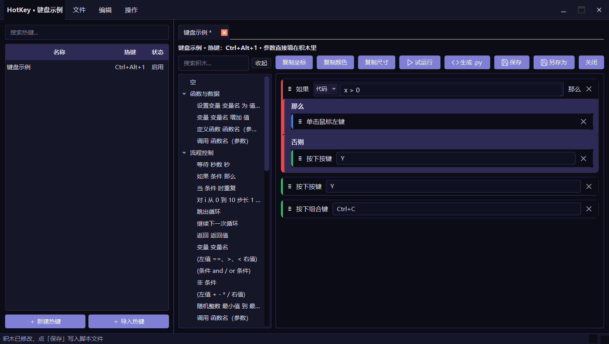
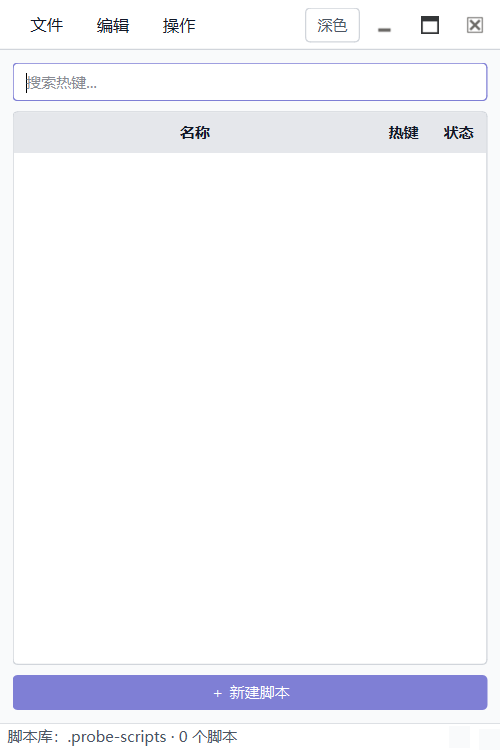

# HotKey — 脚本 / 宏编辑器

给不会写代码的人用的可视化脚本工具：左侧是脚本库，右侧用中文积木拼脚本。脚本可以直接运行、绑定全局热键运行，或者导出成可独立运行的 Python 文件。基于 **PySide6**，界面用 **Qt Designer** 的 `.ui` 文件维护。

> 旧版 Tkinter 实现保留在 `legacy/`，可执行 `python main_tk.py` 对比；迁移计划见 [docs/PLAN-qt-migration.md](docs/PLAN-qt-migration.md)。



## 功能

- **一个脚本一个文件**：每个脚本是 `hks/` 里的独立 `.hk` 文件（内容是 JSON），互不影响
- **热键列表**：左侧列出全部脚本、热键和启用状态，默认/最大宽度 400px；双击在右侧打开
- **移除与删除分开**：可以只从列表移除（文件移到 `hks/removed/`），也可以彻底删除文件
- **另存为**：保存按钮/菜单支持另存为新 `.hk`，原文件保留
- **键盘按键捕获**：按下/组合键/按住/松开积木点击后直接按实体键盘，自动显示并生成对应按键
- **多标签编辑**：右侧可同时打开多个脚本，标签切换、关闭、拖动排序，带 `*` 表示未保存
- **热键可选**：热键可以留空，只手动运行或导出；监听器只注册有热键的启用项
- **单栏积木编辑**：竖向积木列表，按住左侧 `≡` 拖拽调整顺序，`✕` 删除
- **积木柜检索**：顶部搜索框按中文名 / id / Python 代码过滤，参数用占位符显示，不再是空括号；右侧按钮一键展开/收起分类
- **拖拽预览**：从积木柜拖动时，有一个和积木外观一致的小积木跟随鼠标
- **积木清单**：47 个可见积木的完整清单见 [docs/BLOCKS.md](docs/BLOCKS.md)
- **参数常驻**：数字/文本参数就是积木里的输入框，一直显示，直接填
- **变量与值槽**：设置/增加全局变量；值槽可手填，也可拖入有返回值的积木；数值/文本参数同样支持递归拖值
- **判断/循环**：`如果/否则`、`当…时重复`、`对…从…到…步长…重复`；等待秒数由参数填写
- **函数**：定义函数、函数体里的 `返回 {value}`、调用函数，以及可拖进值槽的“调用函数”返回积木
- **带返回值的内置积木**：比较、数学、随机数、找图、像素、鼠标坐标、屏幕尺寸等；这些积木放在「流程控制」分类里
- **双用途积木**：弹窗输入/确认、鼠标坐标、屏幕尺寸、找图、像素判断等既能单独放一行，也能拖进值槽
- **导出 Python**：生成可直接 `python 文件.py` 运行的脚本，不依赖 HotKey 热键
- **JSON 驱动**：积木目录、中文模板、参数、槽位、Python 转换与转义都在 `hotkey/core/catalog.json`
- **空积木**：左侧最顶上的「空」拖进来，可以自己写一行代码
- **监听器独立进程**：编辑器只管编辑；`F5` 拉起后台监听器，关掉编辑器热键仍生效
- **运行/监听**：手动试运行单个脚本，或让独立监听器常驻后台
- **自定义标题栏 / 深色主题 / 单实例**：菜单并入标题栏，窗口四边可拖拽缩放；托盘只属于监听器

界面固定使用深色主题，不提供浅色模式切换。

## 环境要求

- Windows 10 / 11
- Python 3.10+
- 运行时依赖见 `requirements.txt`（`PySide6-Essentials`、`keyboard`、`pyautogui`）
- 导出的 `.py` 只需要 Python + `pyautogui`，不需要 PySide6

## 安装与运行

```powershell
# 开发环境（含 pytest / pyinstaller）
pip install -r requirements-dev.txt

# 运行
python main.py

# 冒烟测试：启动后自动退出
python main.py --self-test
```

打包：

```powershell
pyinstaller --noconfirm HotKey.spec
# 产物：dist\HotKey\HotKey.exe（onedir）
```

## 使用流程

1. `Ctrl+N` 新建热键，选择 `.hk` 文件名（保存在 `hks/`），热键可以留空
2. 底部「＋ 新建热键」创建新文件；「＋ 导入热键」把外部 `.hk/.json` 复制进 `hks/`
3. 左侧双击热键，在右侧标签里打开；可以同时打开多个
4. 从左侧积木柜把中文积木拖进单栏；按住每块左侧的 `≡` 上下拖拽调整顺序
5. 直接在积木里的输入框/值槽填参数；需要循环/判断/函数时，把其他积木拖进「重复内容」「那么」「否则」「函数体」槽位
6. 点「保存」（`Ctrl+S`）只保存当前热键；「另存为」（`Ctrl+Shift+S`）复制成新的 `.hk`
7. 需要热键时，选中热键按 `Ctrl+H` 设置；`F5` 启动独立监听器，监听器注册所有"有热键且启用"的项
8. 也可以点「运行」直接执行，或「生成 .py」导出后用 `python 文件.py` 运行
9. 关闭编辑器就是退出编辑器；监听器仍在托盘运行，右键托盘「退出监听器」才停止热键

左侧最顶上的「空」是一块空白积木：拖进来后直接在它的输入框里写一行 Python 代码。

单栏**从上到下**就是执行顺序；容器里的积木按放入顺序执行。

## 编辑器与监听器

这是两个独立进程，但共用同一个 `hks/` 脚本库：

| 进程 | 启动方式 | 职责 |
|---|---|---|
| 编辑器 | `python main.py` | 编辑积木、保存脚本、试运行、生成 .py |
| 监听器 | `python main.py --listen` | 托盘、注册热键、执行脚本、监视脚本文件 |

- 编辑器里 `F5` 会拉起同一个程序的 `--listen` 进程；`Shift+F5` 让它退出
- 编辑器没有托盘，关闭窗口就是退出编辑器；监听器继续运行
- 监听器托盘菜单：打开编辑器、暂停/继续监听、退出监听器
- 监听器监视 `hks/*.hk`，保存脚本后自动重新注册热键
- 监听器日志在配置目录的 `logs/listener.log`

## 变量、条件与函数

### 1. 值槽

积木里凡是显示为值的位置（设置变量的值、条件、返回值、循环范围）都是**值槽**：

- 可以直接手填，左侧下拉选择 `自动 / 文本 / 数字 / 布尔 / 代码`
  - 自动：`42` 当数字，`True/False` 当布尔，其余按文本加引号
- 也可以从积木柜「流程控制」里拖入一个**有返回值的积木**，例如比较、随机数、函数调用
- 弹窗输入/确认使用「输入框「提示」返回的内容」「确认框「提示」返回的按钮」值积木，拖进变量或条件后结果不会丢
- 值槽右侧的 `✕` 用来清除表达式，恢复手填

### 2. 变量

- `设置变量 {name} 为 {value}`：新建或覆盖全局变量
- `变量 {name} 增加 {value}`：累加
- 变量名直接填，不需要声明；所有函数共用同一组全局变量

```
设置变量 count 为 1
变量 count 增加 1
如果 (count > 1) 那么
    弹出提示：ok
```

### 3. 条件、循环与流程

- `如果 {condition} 那么` + 「否则」槽位；不提供「否则如果」，需要多级判断时在「否则」里嵌套「如果」
- `当 {condition} 时重复` → `while`
- `对 {name} 从 {start} 到 {end} 步长 {step} 重复` → `for ... in range(...)`
- `等待 {seconds} 秒` 一个积木，秒数自己填，不再有 0.5/1/2/5 四个固定块
- `跳出循环`、`继续下一次循环`
- `返回 {value}` 只能放在函数体里

### 4. 函数与返回值

积木：`定义函数 {name}（参数 {params}）`，带一个「函数体」槽位。

- `name`：函数名，例如 `find_and_click`
- `params`：参数列表，例如 `image, timeout`
- 返回值用函数体里的 `返回 {value}` 积木
- 调用函数：
  - 语句形式：`调用 {name}（{args}）`
  - 值形式：在「流程控制」里的 `调用 {name}（{args}）`，可以拖进变量/条件/返回值槽

生成的代码：

```python
def find_and_click(image, timeout):
    found = pyautogui.locateCenterOnScreen(image)
    if found:
        pyautogui.click(found)
    return found

x = find_and_click('a.png', 3)
```

### 5. 直接写 Python

高级场景保留 `Python 表达式 {code}` 值积木；条件/值槽也可以把类型切到「代码」后直接写表达式。
这是给旧脚本和高级用户的出口，普通脚本优先用可视化积木。

### 5. 导出成独立脚本

「生成 .py」会把当前热键的积木转成一个完整文件：

```python
"""由 HotKey 生成的自动化脚本。..."""

import json
import math
import random
import re
import time

import pyautogui


def double(x):
    return x * 2


def main():
    result = double(3)
    print('result =', result)


if __name__ == "__main__":
    main()
```

函数定义会自动排在文件前部，其余积木放进 `main()`，所以文件可以直接运行：

```powershell
python ctrl_alt_f10.py
```

这种情况下完全不需要 HotKey，也不需要热键；HotKey 只是积木编辑器和代码生成器。

## 脚本文件

**一个热键一个脚本文件，一个脚本一个 `.hk` 文件。**

默认目录：程序旁边的 `hks/`（例如 `hks/填写表单.hk`）。如果那里不可写（例如装在 Program Files），会回退到配置目录下的 `hks/`，日志在配置目录的 `logs/hotkey.log`。旧版本的 `jsons/` 会在首次启动时自动改名为 `hks/`。

`.hk` 只是自定义后缀，内容仍然是 JSON。一个文件一个热键：

```json
{
  "version": 5,
  "hotkeys": [
    {
      "id": "3f2c9a...",
      "key": "ctrl+shift+a",
      "description": "填写表单",
      "enabled": true,
      "script": "pyautogui.click()",
      "blocks": [
        { "kind": "mouse_click", "text": "单击鼠标左键", "params": {}, "children": [], "else_children": [] }
      ]
    }
  ]
}
```

- `key` 可以是空字符串：表示没有热键，只能手动运行或导出
- 文件名就是脚本名；左侧列表显示文件名、热键和启用状态
- 主题、打开的标签等设置保存在配置目录的 `settings.ini`
- 旧版 `hotkeys.json`（一个文件多个热键）会在首次启动时自动拆成单脚本文件，旧文件改名为 `hotkeys.json.migrated`
- 旧版 `.json` 脚本会自动改名为 `.hk`；导入时仍然兼容 `.json`

## 快捷键

| 位置 | 快捷键 | 功能 |
|------|--------|------|
| 主窗口 | `Ctrl+N` | 新建热键文件 |
| 主窗口 | `Ctrl+O` | 导入热键文件 |
| 主窗口 | `Ctrl+S` | 保存当前热键 |
| 主窗口 | `Ctrl+Shift+S` | 另存为新的 `.hk` |
| 主窗口 | `Ctrl+H` | 设置 / 修改当前热键 |
| 主窗口 | `Ctrl+Shift+E` | 导出当前热键为 Python 文件 |
| 主窗口 | `Ctrl+Q` | 退出程序 |
| 主窗口 | `Ctrl+F` | 搜索热键 |
| 主窗口 | `Ctrl+E` | 显示/隐藏积木编辑区 |
| 主窗口 | `F5` / `Shift+F5` | 启动 / 停止独立监听器 |
| 主窗口 | `Ctrl+Del` | 删除选中热键（会删除文件） |
| 积木栏 | `Delete` | 删除选中的积木 |

## 脚本库与编辑标签

### 脚本库

- 左侧列出 `hks/` 里的全部热键，默认/最大宽度 400px；窗口更宽时剩余空间给编辑区
- 双击热键在右侧打开一个标签；右键菜单可以编辑、运行一次、设置热键、清除热键、启用/停用、移除、删除
- 「＋ 新建热键」或 `Ctrl+N` 选择文件名，热键立即写入 `hks/`
- 「＋ 导入热键」把外部 `.hk/.json` 复制进 `hks/`
- **移除（保留文件）**：把文件移到 `hks/removed/`，从列表消失但不删除
- **删除文件**：彻底删除对应 `.hk`（确认后）
- 热键可以没有按键；监听器只注册"有热键、已启用、脚本非空"的那些
- 积木排序：按住积木左侧 `≡` 上下拖，松手后按落点插入；不再使用上下按钮
- 从积木柜拖动时有小积木预览跟随鼠标
- 积木柜搜索：中文名、id、Python 代码、分类名都能匹配；清空搜索恢复全部

### 键盘按键捕获

- 「按下按键」「按下组合键」「按住按键」「松开按键」的按键框点击后，直接按实体键盘
- 按键会自动显示并写入 `.hk`；组合键会显示成 `Ctrl+C` 这类形式
- 「输入文本」「逐字输入」仍然填文本，因为它们输入的是内容而不是单个按键
- 旧的固定按键/组合键块保留为隐藏兼容块

### 编辑标签

- 右侧标签是"正在编辑"的热键，可同时开多个、切换、关闭、拖动排序
- 每个标签独立保存：`Ctrl+S` 只写当前热键文件，未保存显示 `*`
- `Ctrl+Shift+S` 另存为新的 `.hk`，原标签和原文件保留
- 关闭标签或退出时提示保存 / 放弃 / 取消
- 重启会恢复上次打开的标签和当前标签

### 主题

- 固定深色：`#0B0C15` 背景、`#151628` 面板、`#2D2B55` 边框/表头、`#7F7FD5` 强调、`#E5E5F7` 文字
- 不再提供浅色模式，也没有主题切换按钮/菜单
- 主题只影响 HotKey 界面；导出的 `.py` 是普通脚本，没有主题概念

### 自定义标题栏

窗口是无边框的，菜单栏直接并进标题栏同一行：

- 左侧是当前脚本名，紧接着「文件 / 编辑 / 操作」，右侧是窗口按钮
- **只有脚本栏时默认 400×700**；打开编辑标签后自动扩展到 1240×700
- 只有窗口仍处于默认 `400×700`、且未最大化/全屏时才自动扩展；用户手动调过大小后打开编辑区不会重置窗口
- 按住标题栏空白处拖动窗口，双击标题栏最大化/还原
- 窗口**四边和四角都可以拖拽缩放**，右下角也可以缩放
- 右上角依次是：最小化、最大化/还原、关闭
- 关闭编辑器不会停止监听器；监听器在托盘里独立运行
- 托盘菜单：打开编辑器、暂停/继续监听、退出监听器

仅脚本栏时的默认窗口：



## 脚本安全

积木会被翻译成整段 Python，在保存前和执行前各做一次 AST 校验：

- 允许：`pyautogui`、`time`、`datetime`、`math`、`random`、`json`、`re` 以及常用内置函数
- 禁止：`os` / `subprocess` 等模块，`eval` / `exec` / `open` / `__import__` 等调用，`__class__` 等 dunder 属性
- `import` 语句受白名单限制，执行命名空间只注入白名单模块

这是一道防误用的护栏，不是对抗恶意代码的安全边界——「空」积木本来就能写代码。

## 项目结构

```
HotKey/
├── main.py                  # 入口（--self-test）
├── main_tk.py               # 旧版 Tk 入口
├── HotKey.spec              # PyInstaller onedir 配置
├── hks/                   # 脚本库：一个脚本一个 .hk 文件（JSON 内容）
├── hotkey/
│   ├── app.py               # 启动、日志、单实例
│   ├── core/                # 不依赖 Qt，可独立测试
│   │   ├── models.py        # HotKey / Block（名字、路径、参数、分支）
│   │   ├── blocks.py        # 积木树 -> Python 代码
│   │   ├── program.py       # 生成可独立运行的 .py
│   │   ├── library.py       # 单文件脚本库、旧配置拆分迁移
│   │   ├── catalog.json     # 积木表：中文模板、参数、槽位、Python 模板
│   │   ├── catalog.py       # 加载 catalog.json 并提供渲染/转换 API
│   │   ├── storage.py       # v1~v5 迁移、原子写、目录回退
│   │   ├── validator.py     # 整段 AST 校验 + 执行命名空间
│   │   ├── keymap.py        # Qt 键名 <-> keyboard 键名
│   │   ├── hotkey_service.py# 热键注册
│   │   └── runner.py        # 单 worker 执行队列
│   └── ui/
│       ├── forms/           # Designer 源文件（main_window / hotkey_dialog）
│       ├── generated/       # pyside6-uic 生成物（提交入库）
│       ├── widgets/         # BlockListEditor（单栏）、BlockWidget、StatementTree、TitleBar
│       ├── main_window.py   # 编辑器：脚本库、编辑标签、试运行
│       ├── listener.py      # 独立监听器：托盘 + 热键 + 文件热重载
│       ├── logging_setup.py # 编辑器/监听器共用日志
│       ├── icon.py          # 共用应用图标
│       ├── hotkey_model.py
│       ├── recorder.py
│       ├── theme.py         # 深色调色板与 QSS 渲染
│       └── theme.qss        # 使用 $变量 的 QSS 模板
├── tests/                   # pytest + pytest-qt（206 项）
├── docs/ARCHITECTURE.md     # 代码结构说明（读代码先看这个）
├── docs/BLOCKS.md           # 积木柜全部积木清单
├── tools/build_ui.ps1       # .ui -> generated/ui_*.py
└── legacy/                  # 旧 Tk 实现（仅参考）
```

## 开发

第一次读代码先看 [docs/ARCHITECTURE.md](docs/ARCHITECTURE.md)：里面按模块说明主窗口分区、数据流和"改哪里"。

修改界面：用 Qt Designer 打开 `hotkey/ui/forms/*.ui`，保存后重新生成：

```powershell
.\.venv\Scripts\pyside6-designer.exe hotkey\ui\forms\main_window.ui
powershell -ExecutionPolicy Bypass -File tools\build_ui.ps1
```

生成物需要提交；`pytest` 里有一项会用 `build_ui.ps1 -Check` 检查 `.ui` 与生成物是否同步。

新增/修改积木：编辑 `hotkey/core/catalog.json`，每条包含中文 `label`、Python `code`、参数表，容器积木再加 `slots`：

```json
{
  "id": "flow_if_else",
  "category": "flow",
  "label": "如果 {condition} 那么",
  "code": "if {condition}:",
  "block": true,
  "params": [
    { "name": "condition", "placeholder": "条件，例如 x > 0", "kind": "code", "width": 180 }
  ],
  "slots": ["那么", "否则"]
}
```

`label` 里的 `{name}` 会自动变成常驻输入框；`kind` 为 `number` 时只接受数字，`text` 会自动加引号并转义，`code` 原样插入。`slots` 的第一个槽位生成 `children`，第二个生成 `else_children`（配合 `if`）。改完 JSON 不需要改 Python 代码。

测试（无需真实桌面，Qt 使用 offscreen）：

```powershell
pytest
```

## 已知限制

- `keyboard` 库在部分 Windows 环境下需要以管理员身份运行才能收到全局按键
- 录制 `Win+X` 组合键时，系统可能同时响应（例如 `Win+R` 会打开「运行」）
- 数值/文本参数可切换类型或拖入值积木；参数没填完整时保存会提示语法错误
- 单栏按列表顺序执行；容器内按放入顺序执行，嵌套积木不能直接拖出容器（删除后重新拖入）
- 热键运行时函数按列表顺序执行，**调用前必须先定义**；导出的 `.py` 会自动把函数定义提前
- `返回` 积木只能放在函数体里，放在主流程会导致语法错误
- 导出的 `.py` 会导入白名单里的所有模块（`json/math/random/re/time/pyautogui`），即使没用到
- 脚本名就是文件名；暂不支持在应用内重命名文件（可以另存为新文件）
- 「移除」把文件移到 `hks/removed/`，不删除；「删除」才会删掉对应 `.hk`；导入是复制，不移动原文件
- 变量是全局的；函数参数和变量没有类型检查，写错名字要到运行/校验时才报错
- 值槽支持“手填 + 一层返回积木”；返回值积木内部的参数是普通输入框，暂不支持继续嵌套拖值积木
- `for` 只支持数字范围（`range`），没有列表/字典；这是三种基础类型下的刻意限制
- 当前仍保留「代码」类型和 Python 表达式积木兼容旧脚本；普通脚本优先用可视化积木
- 脚本串行执行，长脚本会排队；`time.sleep` 不影响界面和热键注册，但会推迟后续脚本
- 打包产物是 onedir，不是单文件
